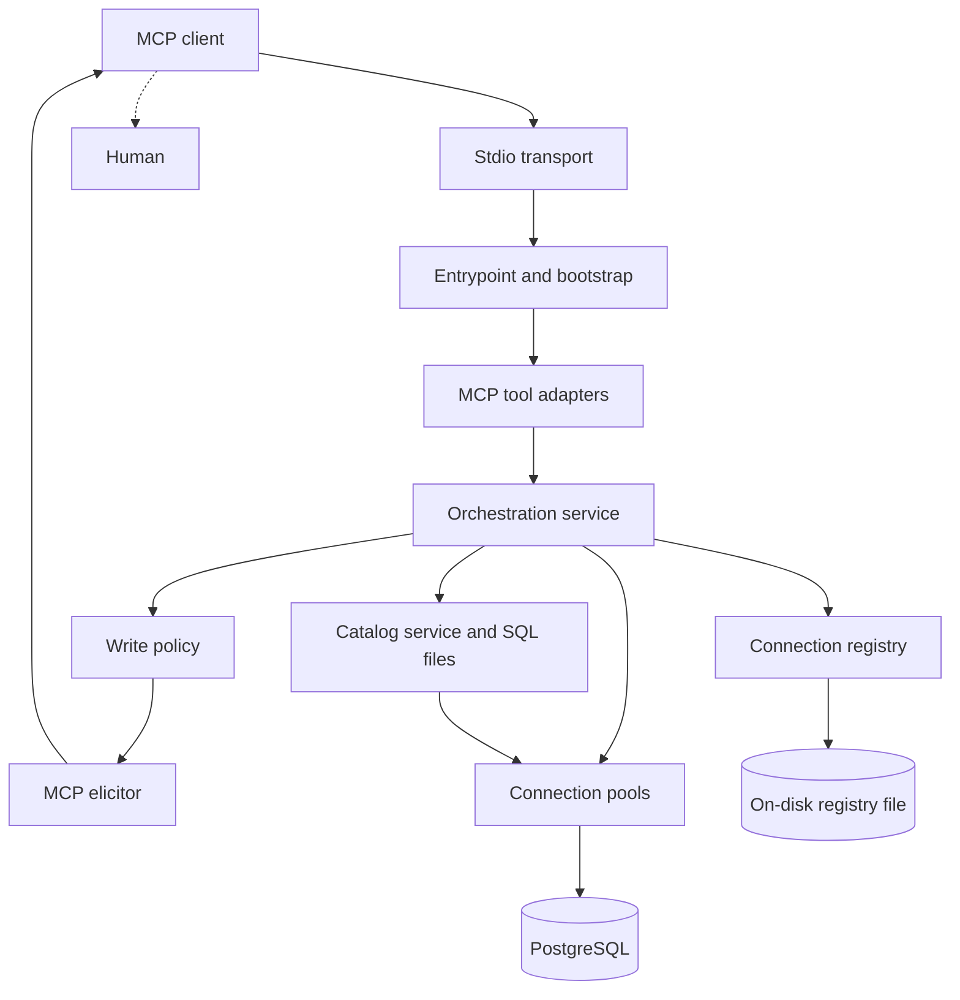
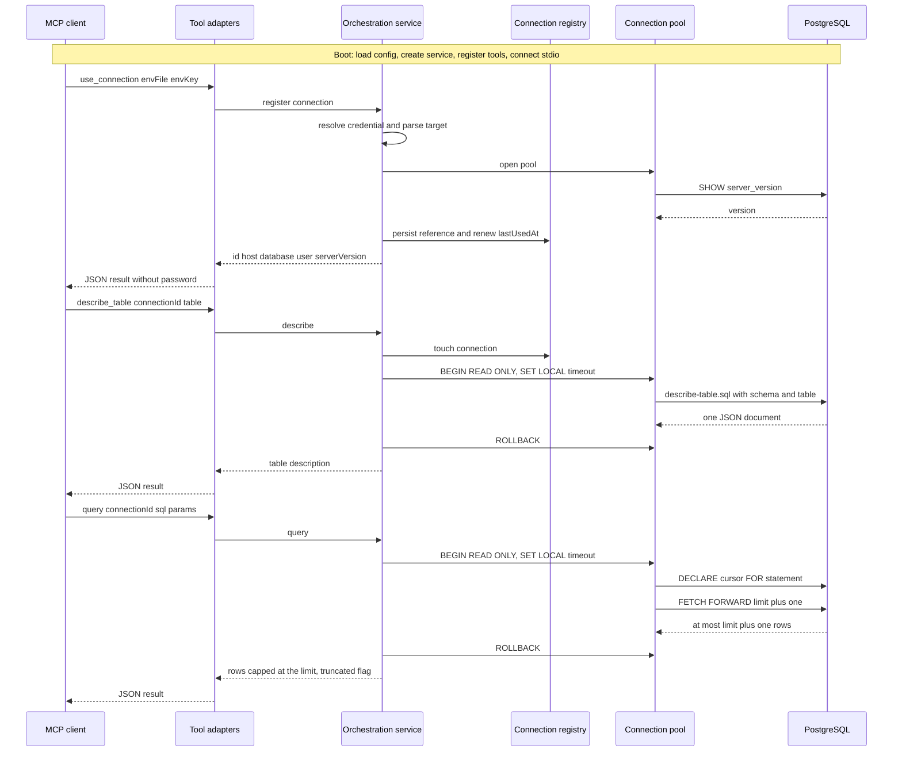
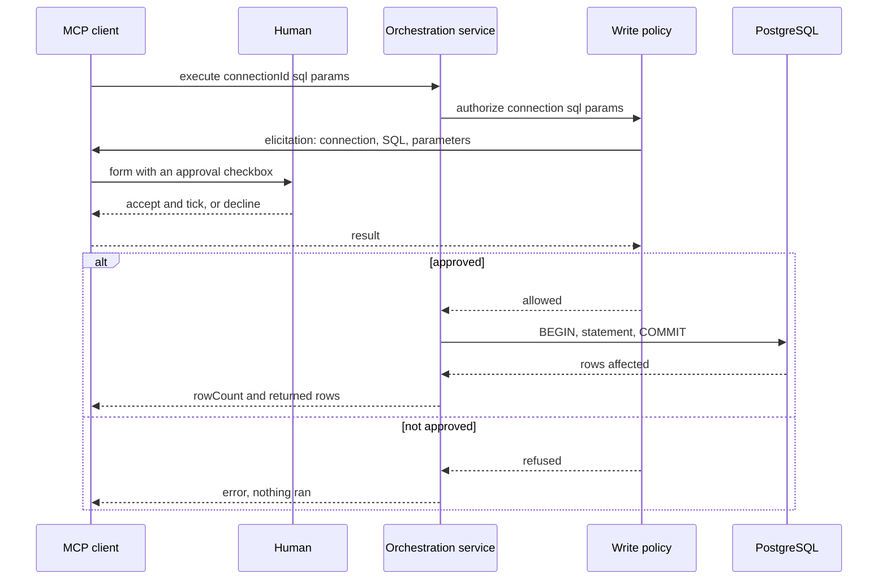

# Architecture

This document describes the communication flow between an MCP client and PostgreSQL databases when using `pg-mcp`.

## Overview

`pg-mcp` is a **native MCP server** built with [`@modelcontextprotocol/sdk`](https://www.npmjs.com/package/@modelcontextprotocol/sdk) and [`pg`](https://www.npmjs.com/package/pg). The MCP protocol is handled directly over stdio.

The server is **global**: it is registered once in the MCP client, and agents register the databases they need at runtime with `use_connection`. Queries are read-only; writes go through a write policy.

| Responsibility                          | Where                                                                                                    |
| --------------------------------------- | -------------------------------------------------------------------------------------------------------- |
| Env → registry path, TTL, limits, mode  | [`src/config.ts`](src/config.ts)                                                                         |
| Boot + tool registration + stdio        | [`src/index.ts`](src/index.ts)                                                                           |
| Thin MCP tool adapters (Zod)            | [`src/tools/*`](src/tools)                                                                               |
| Orchestration façade                    | [`src/services/pg-mcp.service.ts`](src/services/pg-mcp.service.ts)                                       |
| Disk connection registry                | [`src/services/connection-registry.service.ts`](src/services/connection-registry.service.ts)             |
| Catalog reads (schemas, tables, search) | [`src/services/catalog.service.ts`](src/services/catalog.service.ts), [`src/sql/*`](src/sql)             |
| Write permission                        | [`src/services/write-policy.service.ts`](src/services/write-policy.service.ts)                           |
| Ask the human through the client        | [`src/providers/mcp-elicitor.provider.ts`](src/providers/mcp-elicitor.provider.ts)                       |
| Pool creation (`pg`)                    | [`src/providers/pool.provider.ts`](src/providers/pool.provider.ts)                                       |
| Credential resolution, URL parsing      | [`src/utils/resolve.utils.ts`](src/utils/resolve.utils.ts), [`src/utils/url.utils.ts`](src/utils/url.utils.ts) |
| Read-only and write transactions        | [`src/utils/read-only.utils.ts`](src/utils/read-only.utils.ts), [`src/utils/write-transaction.utils.ts`](src/utils/write-transaction.utils.ts) |
| Secret masking                          | [`src/utils/redact.utils.ts`](src/utils/redact.utils.ts)                                                 |

Files are grouped by role: each folder under `src/` holds one kind of file (`constants`, `interfaces`, `types`, `services`, `tools`, `utils`, `providers`, `sql`).

---

## Component layout

---

## Communication flow

Typical agent path: register a connection, read the structure, run a query.

A write goes through the write policy first. With the default `ask` mode and a client that supports elicitation:

---

## Key design decisions

### 1. Global server, on-demand connections

There is no per-project configuration and no connection string in the MCP client config. Agents call `use_connection`; the registry persists what is needed to reconnect and renews `lastUsedAt` on each use. The registry lives in the user's home directory and is shared by every project and agent session.

### 2. Credentials by reference

`use_connection` accepts a literal `databaseUrl`, an `envVar`, or an `envFile` with `envKey`. For the last two the registry stores only the reference (variable name, or file path and key), and the connection string is resolved on every connect. The password therefore stays out of the conversation and off disk, and `refresh_connection` picks up a rotated password.

### 3. Read-only is enforced by the server

`query` and every catalog read run inside `BEGIN READ ONLY` with `SET LOCAL statement_timeout`, and always end in `ROLLBACK`. PostgreSQL itself rejects any write, so no SQL parsing or keyword filtering decides what is allowed. That only holds while the transaction stays open, so every statement is sent in the driver's `extended` query mode (`createPgPool`): the server then accepts exactly one statement per call and refuses a text such as `SELECT 1; COMMIT; DROP TABLE t`, which in the default mode would end the read-only transaction and run the rest with write access. `execute` follows the same rule, so the SQL the human approves is the whole text that runs. Results are capped at a row limit and flagged `truncated`.

### 4. Write policy with a human in the loop

`execute` is always registered. `PG_MCP_WRITES` decides what happens: `off` refuses, `on` runs, and `ask` (default) asks the human through MCP elicitation, showing the connection, the exact SQL, and the parameters. Anything other than an explicit, ticked acceptance counts as "no". When the client cannot ask, the agent's `confirmedByUser` claim is accepted as a soft fallback; it never bypasses a question the client can show.

### 4b. Row limits are applied by the server

A cap applied after reading the result would still load every row into memory first: a `SELECT *` over millions of rows finishes well inside the statement timeout and can take hundreds of megabytes. `query` therefore reads through a server-side cursor (`DECLARE ... CURSOR`, then `FETCH FORWARD limit+1`), so the server hands over at most one row beyond the limit, and that extra row is what tells the caller the result was cut.

Only a statement that starts with `SELECT`, `WITH`, `VALUES`, `TABLE`, or an opening parenthesis is tried as a cursor. `SHOW`, `EXPLAIN`, writes, and invalid SQL run directly, which keeps failed cursor attempts out of the database log. A candidate the server still refuses as a cursor (for example a data-modifying `WITH`) is rolled back and run directly in a fresh transaction, so the caller always sees the statement's own result or error. Writes through `execute` are not cursor-read: a `RETURNING` clause is capped after the fact.

### 5. Catalog queries are SQL files returning JSON

Each catalog tool is one `.sql` file in `src/sql` that returns a single JSON document already shaped like the result (`jsonb_build_object`). The `CatalogService` loads the file once, runs it, and unwraps the document, so there is no row-mapping code and no SQL inside TypeScript. The queries read `pg_catalog` directly, which is faster than `information_schema` and lists objects regardless of the role's ownership. A table description needs one query in one transaction, and it includes the enum labels of enum columns and the estimated row count taken from `pg_class` statistics. `search_schema` is one query too: it matches table and column names case-insensitively, treating `%` and `_` in the term literally, and caps the matches per kind.

### 6. Secrets stay out of results and errors

Credentials given by `envVar` or `envFile` are resolved on every connect and never stored; a literal `databaseUrl` is stored as given in the registry file (see the README). Every error and tool result passes through `redactSecrets`, which masks the password of any `scheme://user:password@` URL. Original driver errors are not attached as `cause`, because they can embed the connection string. The registry file is written atomically (temporary file, then rename) with owner-only permissions.

### 7. Shared registry, short write window

Every registry operation reloads the file before changing it, and writes are atomic (temporary file, then rename), so a reader never sees a half-written file and two sessions registering at different moments both keep their entries. There is no file lock: two writes in the very same instant can drop one update, and the agent recovers by registering that connection again.

### 8. Thin tools, fat service

Tool modules under `src/tools/` validate inputs with Zod and wrap results as JSON text or `isError`. `PgMcpService` owns orchestration across registry, pools, catalog, and write policy. Errors are returned as tool error results, never thrown through the transport.

### 9. Lazy pools, bounded and resilient

A pool is created when a connection is registered, or reopened from the registry the first time a restarted process uses it. Pools are small (3 connections), close idle connections, and fail fast when the host is unreachable. A dropped idle connection does not crash the server. Shutdown closes the pools and leaves the registry untouched.

### 10. Injectable seams for tests

The driver pool, the clock, and the way the human is asked are injected, so unit tests cover registry TTL, credential resolution, the read-only and write transactions, and the write policy without a database. A separate spec runs the service against a real PostgreSQL (`PG_MCP_TEST_URL`) to verify the catalog SQL and the read-only guarantee.
